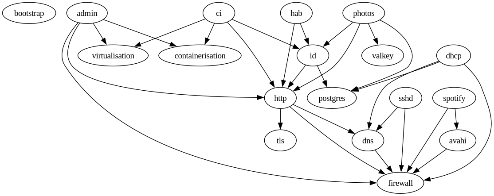

# Home Lab Server

Ansible scripts to deploy the homelab services at matbooth.co.uk.

## Roles

Purpose of the top level roles:

* id - User identity provider and SSO service for other apps
* photos - Immich for photo and video management
* ci - Jenkins for on-prem continuous integration
* sshd - SSH for restricted user shell accounts
* admin - Cockpit for system administration and monitoring
* cams - Zoneminder for CCTV monitoring and recording
* hab - OpenHAB for home automation
* spotify - Spotify Connect implementation to play music through the big stereo

### Dependencies

This dependency graph show roughly how the roles all hang together:



## Pre-requisites

### Key Server

Clevis is used for automatic boot-time decryption of LUKS encrypted volumes using keys stored in a Tang server. There is a DHCP reservation for my main workstation at `192.168.1.11`, and Clevis expects Tang to be running there. Installation process for that is as follows:

```
# dnf install tang
# semanage port -a -t tangd_port_t -p tcp 7500
# firewall-cmd --zone=libvirt --add-port=7500/tcp
# cat <<EOF | sudo tee -a /etc/systemd/system/tangd.socket.d/override.conf
[Socket]
ListenStream=
ListenStream=7500
EOF
# systemctl daemon-reload
# systemctl enable --now tangd.socket
```

### Router Configuration

When using the ISP supplied router, some configuration is needed to make everything work nicely with the self-hosted network services. This section lists settings changed from the router defaults.

Connect to the router as user 'engineer' and the same password as the web interface. This gives access to the Technicolor CLI, which is loosely based on OpenWRT/uci:

```
$ ssh engineer@192.168.1.1
engineer@192.168.1.1's password:
engineer>
```

Disable DHCP services on the router, we are providing our own DHCP:

```
set uci.dhcp.dhcp.@lan.dhcpv4 disabled
set uci.dhcp.dhcp.@lan.dhcpv6 disabled
apply
```

Announce our own DNS server in IPv6 router advertisements. Prevents LAN clients from incorrectly getting the router as a DNS server in addition to those configured by DHCP, which could result in confusing failures if the client picked the wrong DNS server to attempt name resolution:

```
add uci.dhcp.dhcp.@lan.dns.
set uci.dhcp.dhcp.@lan.dns.@1.value 2001:8b0:a722::a
apply
```

The above means LAN clients shouldn't use the router for DNS, but if they do, we need to forward DNS queries for `matbooth.co.uk` names to our own DNS server. This means LAN clients that ask the router get LAN addresses rather than external ones that can't be routed:

```
add uci.dhcp.dnsmasq.@dnsmasq.server.
set uci.dhcp.dnsmasq.@dnsmasq.server.@1.value /matbooth.co.uk/192.168.1.10
add uci.dhcp.dnsmasq.@dnsmasq.rebind_domain.
set uci.dhcp.dnsmasq.@dnsmasq.rebind_domain.@1.value matbooth.co.uk
apply
```

Don't masquerade traffic forwarded into the LAN, so servers see real client addresses instead of the router's address. This makes server logs more useful and allows fail2ban to be used:

```
set uci.firewall.zone.@lan.masq 0
apply
```

Use the web interface to forward ports 80, 443, and 22 to `192.168.1.10` for Apache and SSHd.

## First Run

```
$ ./run.sh        # Staging VM
$ PROD=1 ./run.sh # Real hardware
```

If a machine has not yet been provisioned, the script will provision a VM (staging) or boot USB stick to be used on real hardware (production).

Once provisioned, a bootstrap playbook will be executed to configure fundamentals like network adapters, user accounts, public key authentication, LUKS decryption, etc.

## Subsequent Runs

```
$ ./run.sh        # Staging VM
$ PROD=1 ./run.sh # Real hardware
```

Subsequent runs will execute the main playbooks to install and configure all the services. Provisioning and bootstrapping will be skipped.

